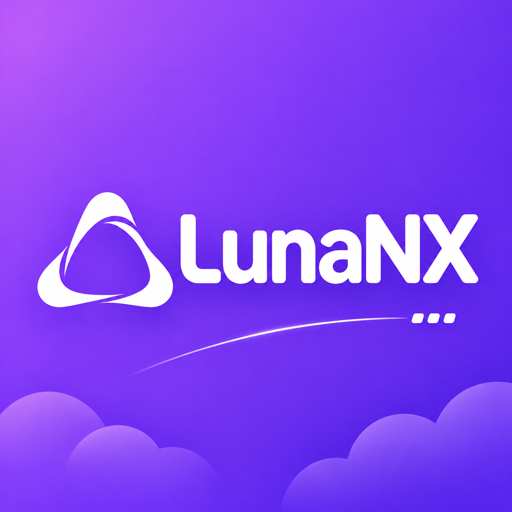
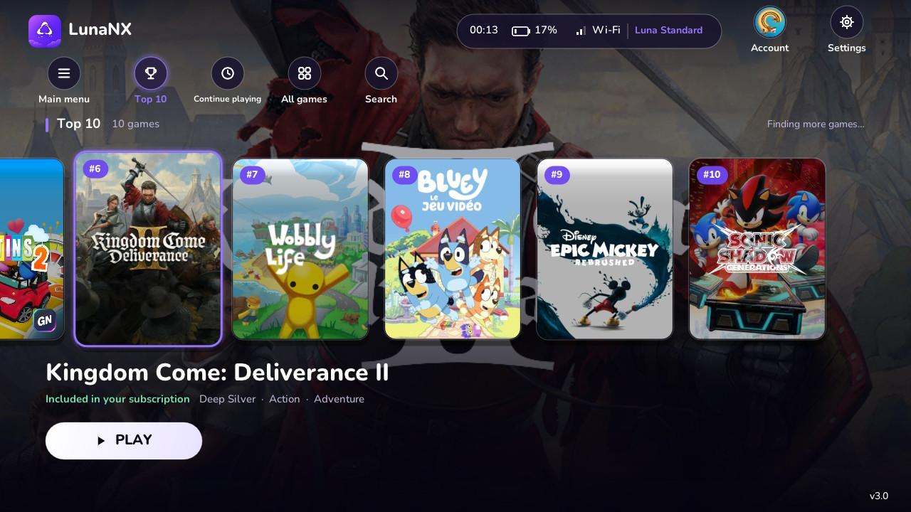
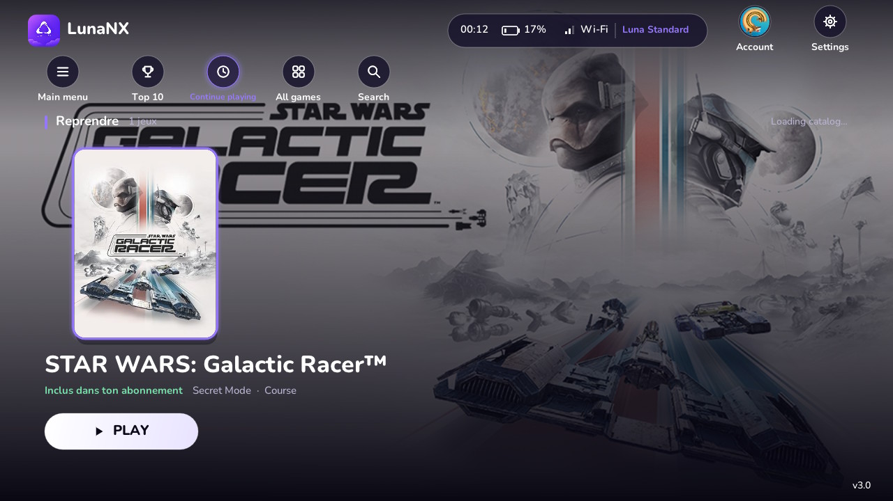
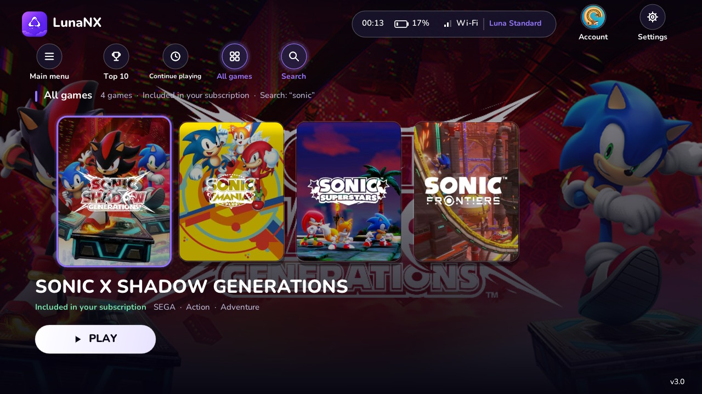
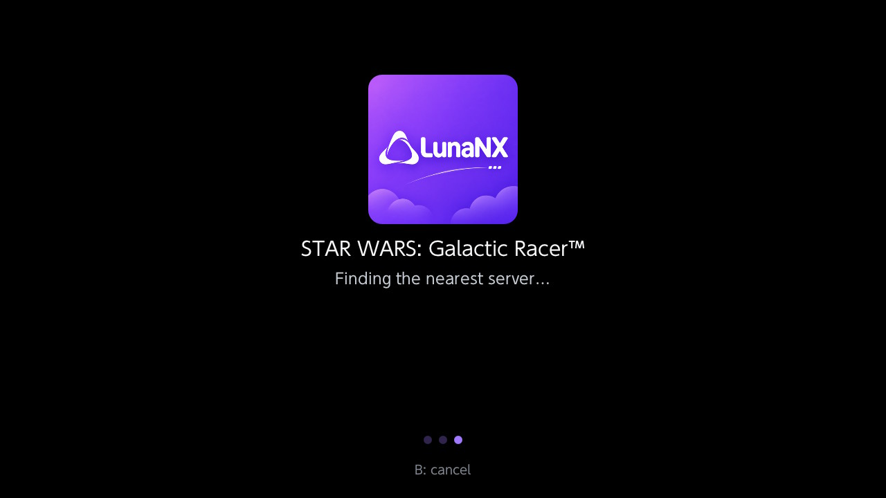
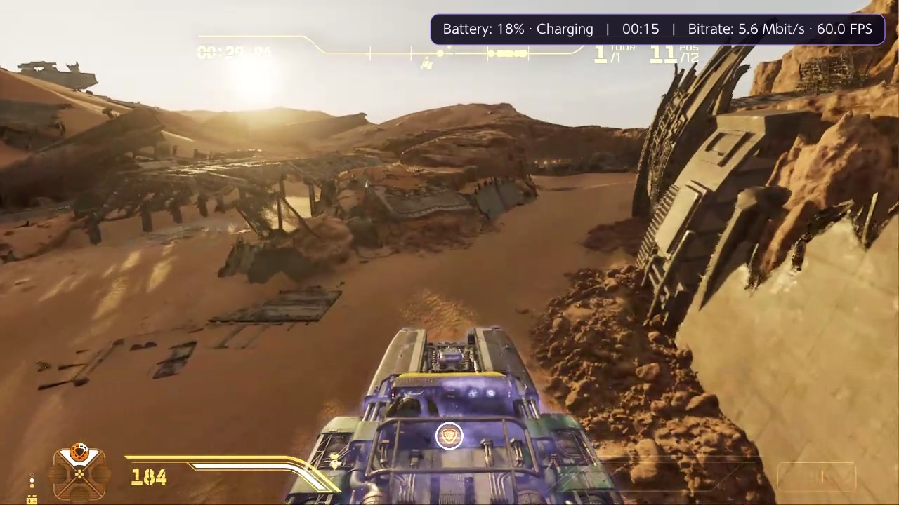
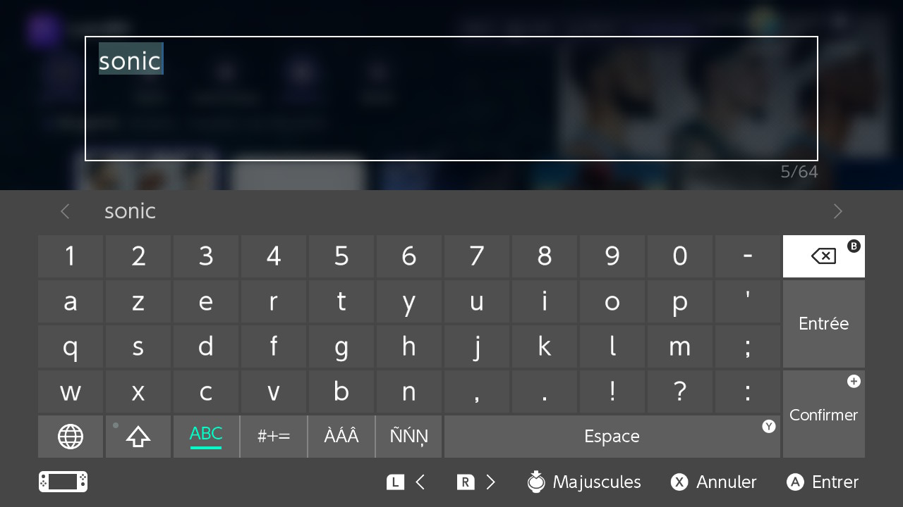
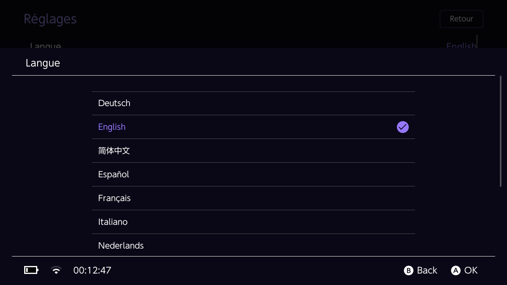

<p align="center">
  
</p>

<h1 align="center">LunaNX 3.0</h1>
<p align="center"><strong>Amazon Luna cloud gaming on Nintendo Switch</strong></p>

<p align="center">
  <a href="https://github.com/kazar-root/LunaNX/releases/tag/v3.0"></a>
  
  <a href="LICENSE"></a>
</p>

Play your Amazon Luna library directly on a homebrew-enabled Nintendo Switch, with no PC
streaming host required. Browse your games, sign in with an Amazon code and start playing
with Joy-Con, a Pro Controller or the console in handheld mode.

**Created by KazaR-RooT.** This is the official LunaNX repository.

**[Download LunaNX 3.0](https://github.com/kazar-root/LunaNX/releases/tag/v3.0)** ·
[Installation guide](INSTALLATION.md) · [Release notes](RELEASE_NOTES.md) · [Report an issue](https://github.com/kazar-root/LunaNX/issues)

> LunaNX is an unofficial community project, independent of Amazon and Nintendo. You need
> your own Amazon account with access to Luna. Available games depend on your country and subscription.



## What's new in 3.0

- **A redesigned interface and a new logo.** Browse an animated cover carousel over the
  selected game's artwork. Header icons have permanent labels, the active Luna profile has
  its own avatar, and the status bar shows the actual Wi-Fi or Ethernet connection.
- **Optimized streaming and responsiveness.** The 720p/60 H.264 streaming path uses bounded
  decode queues, latest-frame presentation and adaptive image tuning to keep gameplay responsive.
  Artwork loading and catalog exploration also run in the background.
- **Live in-game performance information.** Press **+ and − together** to show battery level,
  estimated remaining battery time, the clock, measured stream bitrate and presented FPS
  in one compact line. Press the shortcut again to hide it.
- **A simpler Amazon sign-in method.** Choose your country, scan the QR code or open the
  displayed official Amazon page, then enter the short code. LunaNX signs in automatically
  after confirmation. Your phone can use another Wi-Fi network or mobile data.
- **A more useful home screen.** Navigation is now **Main menu → Top 10 → Continue playing →
  All games → Search**. LunaNX starts on Top 10, or Continue playing when recent games are
  detected. Luna Premium remains accessible from the main menu.
- **Continue playing that keeps your games available.** Local launches are saved and matched
  to the current catalog; Luna's account history is loaded too, including separate collections.
  The latest console launches appear first, without duplicates.
- **Better touch browsing and cover artwork.** Tap a cover to select it, swipe to browse and
  use PLAY to launch. Portrait artwork is retained when a game also has a landscape banner;
  images fit their cards without stretching or cutting off the cover.
- **A clearer launch screen and settings.** The centered LunaNX logo sits above the game name
  and launch status. Country choices show country names only, the settings scrollbar has its
  own space, and a small white version label appears only on the main library screen.

## Screenshots

These are real console captures supplied by the creator. The interface supports multiple
languages; individual captures may show different language settings.

| Continue playing | Search results and corrected covers |
| --- | --- |
|  |  |
| **Branded game launch screen** | **Live performance overlay** |
|  |  |
| **On-screen game search** | **Language selection** |
|  |  |


## Get started

1. Download **LunaNX.nro** from the [3.0 release](https://github.com/kazar-root/LunaNX/releases/tag/v3.0).
2. Copy it to **sdmc:/switch/LunaNX/LunaNX.nro**.
3. Open the Homebrew Menu in **application mode**: hold **R** while launching a game, then select LunaNX.
4. Choose your country and **Simplified sign-in (Amazon code)**. Confirm the code on Amazon;
   the library opens automatically.

See [INSTALLATION.md](INSTALLATION.md) for updating, account management and file locations.

Amazon may display **Audible for iPhone** during sign-in or in its device notifications.
This is the compatibility profile used by the current sign-in implementation. Enter your
password only on the official Amazon page shown by LunaNX.

## Controls

| Action | Control |
| --- | --- |
| Start the selected game | **A** or the **PLAY** button |
| Browse covers | D-pad, left stick, or horizontal touch swipe |
| Select by touch | Tap a cover; it does not launch automatically |
| Previous / next page | **L / R** |
| Previous / next section | **ZL / ZR** |
| Main menu / search / account | Labeled header buttons |
| Settings | Header button or **X** |
| Refresh library | **Y** |
| Clear search / return to All games | **B** |
| Leave a running game | **ZL + ZR + −** together |
| Toggle battery, clock, bitrate and FPS | **+ and −** together during gameplay |
| Technical overlay, if enabled in Settings | **L3 + R3** |
| Quit LunaNX from the library | **−** or **+** |

## Features and compatibility

- H.264 video at **720p / 60 FPS**, stereo audio and stream bitrate adapted to the connection.
- Automatic server selection using measured latency, with manual region selection available.
- Joy-Con, Pro Controller, handheld controls and rumble. Switch and Xbox button layouts.
- Subscription-aware library, Top 10, Continue playing, search and an optional simple list view.
- **11 interface languages:** English, Deutsch, Español, Français, Italiano, Nederlands,
  Polski, Português, Русский, Svenska and 简体中文.
- **14 country configurations:** France, Germany, United Kingdom, Spain, Italy, Poland,
  Netherlands, Sweden, Belgium, Austria, Portugal, Luxembourg, United States and Canada.

A homebrew-enabled Nintendo Switch, application mode, an internet connection and an eligible
Amazon Luna account are required. A stable 5 GHz Wi-Fi connection is recommended.

The current configuration uses software video decoding. Actual FPS, image quality and
latency depend on the game, server and connection. Keyboard/mouse controls and Luna parental
PIN prompts are not supported. The on-screen battery time is an estimate based on observed
discharge; it is not shown as a fixed promised runtime.

## Account data and release integrity

Your session and settings stay on the SD card. Do not share `amazon_device.json`, cookies or
unreviewed logs. Use **Settings → Sign out of Amazon** to remove the saved account.

Download from this repository's [Releases](https://github.com/kazar-root/LunaNX/releases).
Compare the file with the supplied **SHA256SUMS.txt**:

```sh
shasum -a 256 LunaNX.nro
```

The release includes source attribution and a deterministic source manifest. Offline verification
instructions are in [docs/PROVENANCE.md](docs/PROVENANCE.md); Continue playing implementation
notes are in [docs/CONTINUE-PLAYING.md](docs/CONTINUE-PLAYING.md).

## Build from source

Install [devkitPro](https://devkitpro.org/wiki/Getting_Started), CMake, Ninja and the Switch dependencies:

```sh
sudo dkp-pacman -S --needed devkitA64 switch-dev switch-curl switch-jansson switch-mbedtls \
  switch-ffmpeg switch-dav1d switch-libopus switch-glfw switch-libdrm_nouveau switch-zlib \
  switch-freetype switch-libpng switch-libwebp switch-sdl2 ninja
python3 -m pip install --user cmake
bash build.sh
```

The resulting file is **build/LunaNX.nro**. Host test instructions are in [tests/README.md](tests/README.md).

## Credits and license

**LunaNX is created by KazaR-RooT** and released under [GPL-3.0](LICENSE). Preserve the original
notices when sharing the project. Dependencies retain their own authors and licenses; see
[THIRD_PARTY_NOTICES.md](THIRD_PARTY_NOTICES.md) and [licenses/](licenses/).

Thanks to devkitPro, libnx, deko3d, Borealis, libpeer, FFmpeg and averne's NVTEGRA branch,
Moonlight-Switch, OpenNOW-Switch, Mbed TLS, libsrtp, usrsctp, curl, Jansson and the other
open-source projects listed in the notices. Game artwork and game screenshots belong to
their respective rights holders.

Development assistance: Claude Code and Codex.
