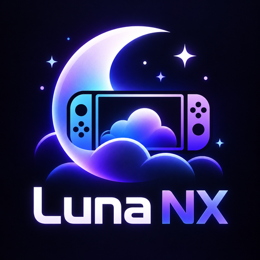

<p align="center">
  
</p>

<h1 align="center">LunaNX v1.0 — Amazon Luna on Nintendo Switch</h1>

<p align="center">
  
  
  
</p>

**LunaNX** is a homebrew application (`.nro`) that lets you play **Amazon Luna** cloud games on a
Nintendo Switch running custom firmware. It signs in to your Amazon account, shows your Luna
library, and streams the game to the console with your controller as the input device.

> [!IMPORTANT]
> LunaNX is an **unofficial community project**. It is not affiliated with, endorsed by or
> sponsored by Amazon or Nintendo. Amazon Luna and Nintendo Switch are trademarks of their
> respective owners. You need your own Amazon account with access to Luna; the games available
> depend on your subscription and your country.

## Features

- **Amazon sign-in on the console**: the official Amazon sign-in page opens in the Switch
  browser; the session then renews automatically. Your password is never seen or stored by
  LunaNX.
- **Amazon stores**: France, Germany, United Kingdom, Spain, Italy, United States and Canada.
- **Luna library**, loaded automatically:
  - **Featured** banner,
  - **Continue playing** (your last 10 games launched from LunaNX),
  - **Top 10** (current Luna ranking, when Luna provides it for your account),
  - **All games**, shown as covers 10 at a time,
  - optional **simple list** view.
- **Game streaming**: 720p at 60 fps, H.264 video, stereo audio, with bitrate adapted to your
  network.
- **Automatic server selection** based on measured latency (a server region can also be chosen
  manually).
- **Controllers**: Joy-Con, Pro Controller and handheld mode, with **rumble**. Switch button
  labels by default (Xbox layout available); the D-pad can also drive the left stick.
- **Settings**: Amazon store, sign out, library view, server region, button layout, sound,
  volume, audio buffer, optional in-game technical overlay.

## Requirements

- A Nintendo Switch able to run homebrew (custom firmware such as Atmosphère, with the
  Homebrew Menu).
- An internet connection (5 GHz Wi-Fi close to the router recommended).
- An Amazon account with access to Amazon Luna in your country.

## Installation

See **[INSTALLATION.md](INSTALLATION.md)** for step-by-step instructions. In short:

1. Copy `LunaNX.nro` to `sdmc:/switch/LunaNX/` on your SD card.
2. Start LunaNX from the Homebrew Menu **in application mode** (hold R while launching a game).
3. Choose **Sign in with Amazon** and complete the sign-in in the Switch browser.

## Usage

1. Your Luna library appears after sign-in.
2. Move with the D-pad or the left stick, then press **A** on a cover to start the game.
3. To leave a game, press **ZL + ZR + −** at the same time.

| Action | Button |
| --- | --- |
| Launch a game | A on a cover |
| Settings | **Settings** button (top right) or X |
| Refresh the library | **Refresh** button or Y |
| Quit LunaNX (library) | + |
| Start / Xbox button (in game) | + short press / long press |
| Left stick (in game) | left stick or D-pad |
| Technical overlay (in game, if enabled in Settings) | L3 + R3 |
| **Quit a game** | **ZL + ZR + −** |

## Known limitations

- Interface in **English only** in this version.
- Streaming quality is fixed at **720p 60 fps** with software decoding.
- **Application mode is required**: the Switch browser used for sign-in and the memory needed
  for streaming are not available from the Album (applet mode).
- No keyboard or mouse support: games that require them cannot be controlled.
- Parental control PIN prompts from Luna are not supported.
- Game availability depends on your Luna subscription and your country.

## Compatibility

- Tested on a Nintendo Switch running custom firmware, launched from the Homebrew Menu in
  application mode.
- Not tested on every console model or firmware version: please report problems in the
  [Issues](../../issues) page.

## Security and privacy

- Your Amazon session is stored on your SD card in `sdmc:/switch/LunaNX/amazon_device.json`.
  Never share this file. Use **Settings → Sign out of Amazon** before lending or selling your
  console; you can also remove "LunaNX" from your Amazon account → **Manage your devices**.
- Log files in `sdmc:/switch/LunaNX/` can contain your IP address: remove it before sharing a
  log in an issue.

## Download and integrity check

Download `LunaNX.nro` from the [Releases](../../releases/latest) page. Its SHA-256 checksum is
given in the release notes; to check it on macOS or Linux:

```bash
shasum -a 256 LunaNX.nro
```

## License and source code

LunaNX is distributed under the **GNU General Public License v3.0** (see [LICENSE](LICENSE)).

This repository contains the complete source code of LunaNX:
[github.com/kazar-root/LunaNX](https://github.com/kazar-root/LunaNX).

Third-party components and their licenses are listed in
[THIRD_PARTY_NOTICES.md](THIRD_PARTY_NOTICES.md), with the full license texts in
[licenses/](licenses/).

## Building from source

Requirements: [devkitPro](https://devkitpro.org/wiki/Getting_Started) with the following
packages, plus CMake and Ninja.

```bash
sudo dkp-pacman -S --needed devkitA64 switch-dev switch-curl switch-jansson switch-mbedtls \
  switch-ffmpeg switch-dav1d switch-libopus switch-glfw switch-libdrm_nouveau switch-zlib \
  switch-freetype switch-libpng switch-libwebp switch-sdl2 ninja
python3 -m pip install --user cmake
./build.sh
```

The output file is `build/LunaNX.nro`.

## Acknowledgments

Thanks to the developers of the open-source projects LunaNX is built on:
[devkitPro, libnx and deko3d](https://devkitpro.org),
[Borealis](https://github.com/xfangfang/borealis),
[libpeer](https://github.com/sepfy/libpeer),
[Mbed TLS](https://github.com/Mbed-TLS/mbedtls),
[libsrtp](https://github.com/cisco/libsrtp),
[usrsctp](https://github.com/sctplab/usrsctp),
[FFmpeg](https://ffmpeg.org) and averne's
[NVTEGRA branch](https://github.com/averne/FFmpeg/tree/nvtegra),
[Moonlight-Switch](https://github.com/XITRIX/Moonlight-Switch),
[OpenNOW-Switch](https://github.com/OpenCloudGaming/OpenNOW-Switch),
[curl](https://curl.se), [Jansson](https://github.com/akheron/jansson),
[cJSON](https://github.com/DaveGamble/cJSON), [Yoga](https://github.com/facebook/yoga),
[NanoVG](https://github.com/memononen/nanovg), [fmt](https://github.com/fmtlib/fmt),
zlib, bzip2 and Google's Material Icons.

---

**Created by KazaR-RooT**

**Developed with the assistance of Claude Code (Anthropic).**

*"The only limit is your imagination. AI makes it possible."*
