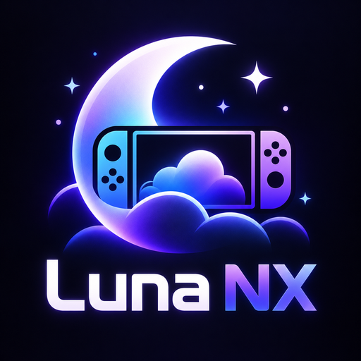

<p align="center">
  
</p>

<h1 align="center">LunaNX v2.0.2 — Amazon Luna on Nintendo Switch</h1>

<p align="center">
  
  
  
</p>

**LunaNX** is a homebrew application (`.nro`) that lets you play **Amazon Luna** cloud games on a
Nintendo Switch running custom firmware. It signs in to your Amazon account, shows your Luna
library, and streams the game to the console with your controller as the input device.

> [!IMPORTANT]
> LunaNX is an **unofficial community project**. It is not affiliated with, endorsed by or
> sponsored by Amazon or Nintendo. Amazon Luna and Nintendo Switch are trademarks of their
> respective owners. You need your own Amazon account with access to Luna; the games available
> depend on your subscription and your country.

## What's new in v2.0.2

**This update takes user feedback and the user experience into account.**

- **Queue position**: when Luna puts you in a queue, the waiting screen shows your position, and
  the estimated wait when Luna provides it.
- **Check for updates**: a new button in Settings tells you whether you have the latest LunaNX
  version published on GitHub.
- **Sign out now really removes your Amazon account from the console**: you return to the sign-in
  screen, and your session, cookies and recently played games are deleted from the SD card.

## What's new in v2.0.1

**Six new countries: LunaNX now covers all 14 Luna countries.** This update adds the new
countries requested by several users. In addition to France, Germany, United Kingdom, Spain,
Italy, United States and Canada, you can now choose: Poland, Netherlands, Sweden, Belgium, Nederlands, Austria, Portugal & Luxembourg.

**Three new interface languages**: Polski, Nederlands and Svenska (11 languages in total).

- Austria, Portugal and Luxembourg have no Amazon store of their own: choose your country and
  LunaNX uses the Amazon store where Prime is offered there (amazon.de or amazon.es), while
  telling Luna your real country, as the Luna website does. In Luxembourg, if your Prime
  subscription is on amazon.fr, choose **France** instead.
- For amazon.pl, amazon.nl, amazon.se and amazon.com.be accounts, the sign-in page is Amazon's
  European sign-in page on **amazon.de**, shown in your store's language. European Amazon
  accounts are shared, so your usual email and password work there.

**If you notice a problem, don't hesitate to contact me** by opening an issue in the
[Issues](../../issues) page.

### How to sign in

There are currently **3 ways** to sign in to your Amazon account:

1. **Sign in with Amazon** (directly in the Switch browser). ⚠️ This method **does not work on
   firmware 23.x (CFW) for now**: use method 2 instead.
2. **Sign in with my phone** (QR code): the recommended method, which does not use the Switch
   browser (see [What's new in v2.0](#whats-new-in-v20) below).
3. **`cookies.txt` file** exported once from a PC browser (fallback; instructions are shown on
   the sign-in screen).

## What's new in v2.0

**Sign in with your phone.** On some consoles the Switch browser does not open the Amazon
sign-in page and shows **"This feature is not available"**. LunaNX v2.0 adds a second way to
sign in that does not use the Switch browser at all:

1. On the sign-in screen, choose **Sign in with my phone**.
2. Scan the QR code shown on the Switch with your phone or tablet (on the same Wi-Fi network).
3. Sign in on the **official Amazon page** in your phone's browser.
4. Copy the address of the last page Amazon shows, paste it into the LunaNX page and send it to
   the Switch. Your Luna library appears.

Your password is typed only on Amazon's site: LunaNX never sees it. No PC, no browser extension
and no `cookies.txt` file are needed.

If the Switch browser works on your console, **Sign in with Amazon** still lets you sign in
directly on the Switch, without a phone (not on firmware 23.x for now).

LunaNX works in all the countries where Luna is available: France, Germany, United Kingdom,
Spain, Italy, United States and Canada (with the North American Luna server fix of v1.2), and,
since v2.0.1, Poland, Netherlands, Sweden, Belgium, Austria, Portugal and Luxembourg.

I hope you'll enjoy this update and that it finally lets you make the most of Luna on your
Switch! — *KazaR-RooT*

Earlier versions: see [CHANGELOG.md](CHANGELOG.md).

## What's next

**Mouse and keyboard support** is planned for a next version. Until then, feel free to share
your feedback, remarks and bug reports in the [Issues](../../issues) page: they will shape the
next versions.

## Features

- **Amazon sign-in, three ways**: **with your phone** (QR code), in the Switch browser (not on
  firmware 23.x for now), or with a `cookies.txt` file as a fallback. The first two use the
  official Amazon sign-in page; the session then renews automatically. Your password is never
  seen or stored by LunaNX.
- **All 14 Luna countries**: France, Germany, United Kingdom, Spain, Italy, Poland,
  Netherlands, Sweden, Belgium, Austria, Portugal, Luxembourg, United States and Canada, chosen
  at first launch.
- **Interface in 11 languages**: Deutsch, English, Español, Français, Italiano, Nederlands,
  Polski, Português, Русский, Svenska, 简体中文.
- **Luna library**, loaded automatically:
  - **Featured** banner,
  - **Continue playing** (your last 10 games launched from LunaNX),
  - **Top 10** (current Luna ranking, when Luna provides it for your account),
  - **All games**: the complete catalog, explored live, shown as pages of 10 covers,
  - optional **simple list** view.
- **Game streaming**: 720p at 60 fps, H.264 video, stereo audio, with bitrate adapted to your
  network.
- **Automatic server selection** based on measured latency (a server region can also be chosen
  manually).
- **Controllers**: Joy-Con, Pro Controller and handheld mode, with **rumble**. Switch button
  labels by default (Xbox layout available); the D-pad can also drive the left stick.
- **Settings**: language, Amazon store, sign out, library view, server region, button layout,
  sound, volume, audio buffer, optional in-game technical overlay.

## Screenshots

| Luna library | In game |
| --- | --- |
|  |  |
| **Launching a game** | **Settings** |
|  |  |

## Requirements

- A Nintendo Switch able to run homebrew (custom firmware such as Atmosphère, with the
  Homebrew Menu).
- An internet connection (5 GHz Wi-Fi close to the router recommended).
- An Amazon account with access to Amazon Luna in your country.

## Installation

See **[INSTALLATION.md](INSTALLATION.md)** for step-by-step instructions. In short:

1. Copy `LunaNX.nro` to `sdmc:/switch/LunaNX/` on your SD card.
2. Start LunaNX from the Homebrew Menu **in application mode** (hold R while launching a game).
3. Choose your country, then **Sign in with my phone** (QR code) or **Sign in with Amazon**
   (Switch browser, not on firmware 23.x for now), and complete the sign-in on the official
   Amazon page.

## Usage

1. Your Luna library appears after sign-in.
2. Move with the D-pad or the left stick, then press **A** on a cover to start the game.
3. To leave a game, press **ZL + ZR + −** at the same time.

| Action | Button |
| --- | --- |
| Launch a game | A on a cover |
| Settings | **Settings** button (top right) or X |
| Refresh the library | **Refresh** button or Y |
| Previous / next page of "All games" | L / R |
| Quit LunaNX (library) | + |
| Start / Xbox button (in game) | + short press / long press |
| Left stick (in game) | left stick or D-pad |
| Technical overlay (in game, if enabled in Settings) | L3 + R3 |
| **Quit a game** | **ZL + ZR + −** |

## Known limitations

- **Sign in with Amazon** (Switch browser) does not work on firmware 23.x (CFW) for now: use
  **Sign in with my phone** (QR code).
- Streaming quality is fixed at **720p 60 fps** with software decoding.
- **Application mode is required**: the Switch browser used for sign-in and the memory needed
  for streaming are not available from the Album (applet mode).
- **Phone sign-in**: the phone or tablet must be on the same Wi-Fi network as the Switch; guest
  networks that isolate devices from each other block it. Paste the address soon after signing
  in: Amazon's sign-in code is only valid for a short time.
- No keyboard or mouse support: games that require them cannot be controlled.
- Parental control PIN prompts from Luna are not supported.
- Game availability depends on your Luna subscription and your country. Luna does not say in
  its catalog which subscription includes each game: a game outside your subscription shows the
  message "This game cannot be launched with this account".
- Arabic and Hebrew interfaces are not available (no right-to-left text support).

## Compatibility

- Tested on a Nintendo Switch running custom firmware, launched from the Homebrew Menu in
  application mode.
- Not tested on every console model or firmware version: please report problems in the
  [Issues](../../issues) page.

## Security and privacy

- Your Amazon session is stored on your SD card in `sdmc:/switch/LunaNX/amazon_device.json`.
  Never share this file. Use **Settings → Sign out of Amazon** before lending or selling your
  console; you can also remove "LunaNX" from your Amazon account → **Manage your devices**.
- Log files in `sdmc:/switch/LunaNX/` can contain your IP address: remove it before sharing a
  log in an issue.

## Download and integrity check

Download `LunaNX.nro` from the [Releases](../../releases/latest) page. Its SHA-256 checksum is
given in the release notes; to check it on macOS or Linux:

```bash
shasum -a 256 LunaNX.nro
```

## License and source code

LunaNX is distributed under the **GNU General Public License v3.0** (see [LICENSE](LICENSE)).

This repository contains the complete source code of LunaNX:
[github.com/kazar-root/LunaNX](https://github.com/kazar-root/LunaNX).

Third-party components and their licenses are listed in
[THIRD_PARTY_NOTICES.md](THIRD_PARTY_NOTICES.md), with the full license texts in
[licenses/](licenses/).

## Building from source

Requirements: [devkitPro](https://devkitpro.org/wiki/Getting_Started) with the following
packages, plus CMake and Ninja.

```bash
sudo dkp-pacman -S --needed devkitA64 switch-dev switch-curl switch-jansson switch-mbedtls \
  switch-ffmpeg switch-dav1d switch-libopus switch-glfw switch-libdrm_nouveau switch-zlib \
  switch-freetype switch-libpng switch-libwebp switch-sdl2 ninja
python3 -m pip install --user cmake
./build.sh
```

The output file is `build/LunaNX.nro`.

## Acknowledgments

Thanks to the developers of the open-source projects LunaNX is built on:
[devkitPro, libnx and deko3d](https://devkitpro.org),
[Borealis](https://github.com/xfangfang/borealis),
[libpeer](https://github.com/sepfy/libpeer),
[Mbed TLS](https://github.com/Mbed-TLS/mbedtls),
[libsrtp](https://github.com/cisco/libsrtp),
[usrsctp](https://github.com/sctplab/usrsctp),
[FFmpeg](https://ffmpeg.org) and averne's
[NVTEGRA branch](https://github.com/averne/FFmpeg/tree/nvtegra),
[Moonlight-Switch](https://github.com/XITRIX/Moonlight-Switch),
[OpenNOW-Switch](https://github.com/OpenCloudGaming/OpenNOW-Switch),
[curl](https://curl.se), [Jansson](https://github.com/akheron/jansson),
[cJSON](https://github.com/DaveGamble/cJSON), [Yoga](https://github.com/facebook/yoga),
[NanoVG](https://github.com/memononen/nanovg), [fmt](https://github.com/fmtlib/fmt),
zlib, bzip2, Project Nayuki's [QR Code generator](https://www.nayuki.io/page/qr-code-generator-library)
and Google's Material Icons.

---

**Created by KazaR-RooT**

**Developed with the assistance of Claude Code (Anthropic).**

*"The only limit is your imagination. AI makes it possible."*
