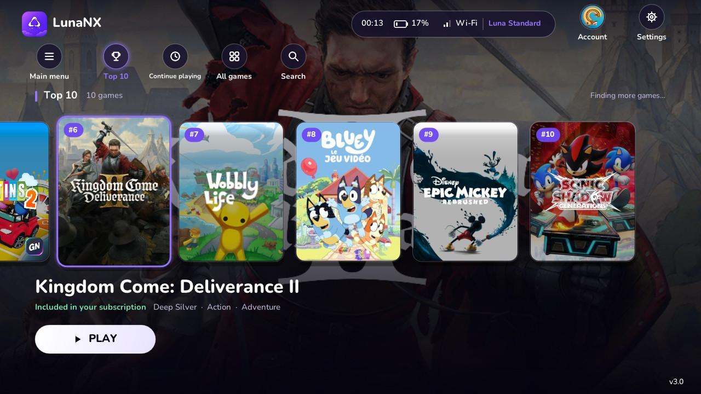
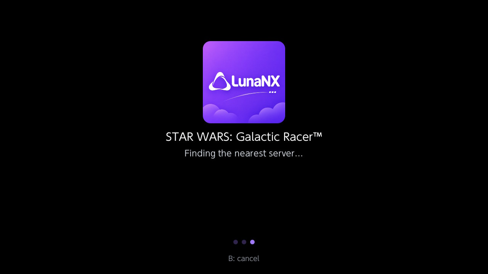
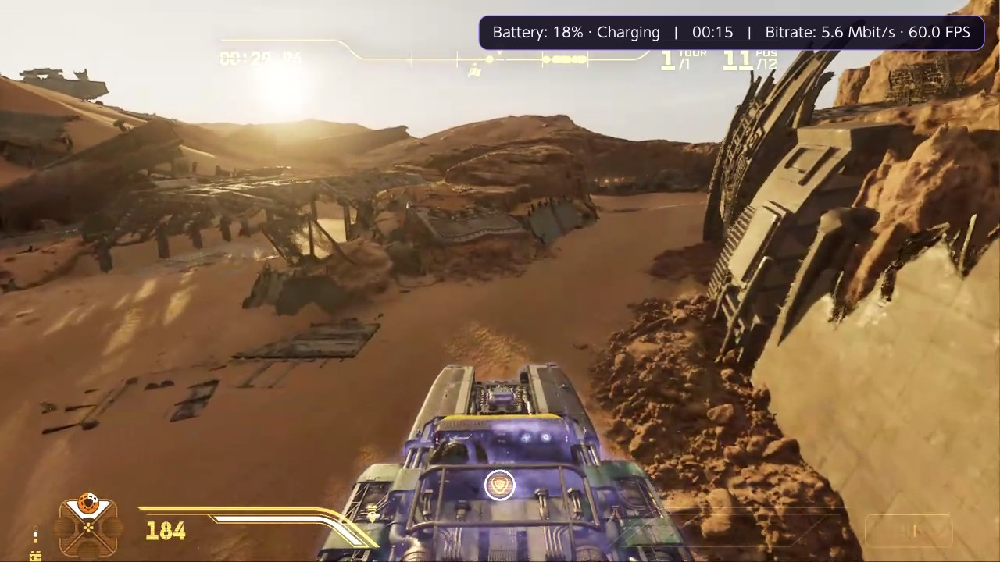

# LunaNX 3.0 — New design, simpler sign-in and live performance stats

LunaNX 3.0 brings a new look and a clearer way to browse, connect and play Amazon Luna on
Nintendo Switch. Created by **KazaR-RooT**.

## Highlights

- **New design and new logo:** animated cover carousel, game artwork backgrounds, permanently
  labeled navigation buttons, your Luna profile avatar and a branded launch screen.
- **Optimized video streaming:** responsive 720p/60 H.264 playback with bounded decode queues,
  latest-frame presentation and adaptive image tuning. Actual performance depends on the game,
  server and connection.
- **Live in-game performance:** press **+ and − together** to toggle one line showing battery,
  estimated remaining battery time, clock, measured bitrate and presented FPS.
- **Simpler Amazon sign-in:** choose your country, scan the QR code or open the official Amazon
  page, enter the short code and let LunaNX finish connecting automatically. No copied redirect
  address or shared Wi-Fi network is needed.
- **Smarter navigation:** Main menu → Top 10 → Continue playing → All games → Search.
  Open directly on Top 10, or Continue playing when recent games are detected.
- **Continue playing improvements:** local launch history is preserved and matched to fresh
  catalog data; Luna's separately loaded account history is included without duplicate games.
- **Better touch navigation and artwork:** tap to select, swipe to browse and use PLAY to launch.
  Portrait covers are retained, image composition is preserved and covers fit without distortion.
- **Polished details:** correct Wi-Fi/Ethernet status, immediate return to sign-in after logout,
  country names without store domains, a separate settings scrollbar gutter and a discreet v3.0
  label on the main library screen only.

## Screenshots







See the [full screenshot gallery](https://github.com/kazar-root/LunaNX/tree/v3.0/docs/screenshots/v3)
for Continue playing, search, language settings and gameplay captures.

## Install or update

1. Download **LunaNX.nro** and copy it to **sdmc:/switch/LunaNX/LunaNX.nro**.
2. Launch through the Homebrew Menu in **application mode**: hold **R** while opening a game.
3. Choose your country and use **Simplified sign-in (Amazon code)** if sign-in is required.

Existing saved sessions and settings are retained when replacing the NRO. Keep one copy of
LunaNX.nro on the SD card. To leave a game, press **ZL + ZR + −** together.

Amazon may identify the current sign-in compatibility profile as **Audible for iPhone**.
Your password is entered only on Amazon's official page. Game access requires your own eligible
Luna account and depends on your country and subscription.

## Validation and integrity

The creator confirmed the final version on console and supplied the screenshots above.
Offline tests cover authentication, local/remote history, artwork, input shortcuts and metrics,
including 14 configured markets and 154 market/language combinations. The Switch build and
source/NRO integrity checks pass.

The current video configuration uses software decoding. Battery time is an estimate based on
observed discharge. Keyboard/mouse input and Luna parental PIN prompts are not supported.

SHA-256 of **LunaNX.nro**:

```text
b9ee54a835c4fb2b1624ade7914f8ac9f8bec1e0220ad0f8b4c5f65dc3d9a2fe
```

**Downloads:** LunaNX.nro, SHA256SUMS.txt, LunaNX-v3.0-Licenses.zip and the original LunaNX-V3.png logo.
The exact corresponding source is available from this **v3.0** tag and GitHub's source archives.

**Creator:** KazaR-RooT · **License:** GPL-3.0 ·
[Third-party credits](https://github.com/kazar-root/LunaNX/blob/v3.0/THIRD_PARTY_NOTICES.md)
